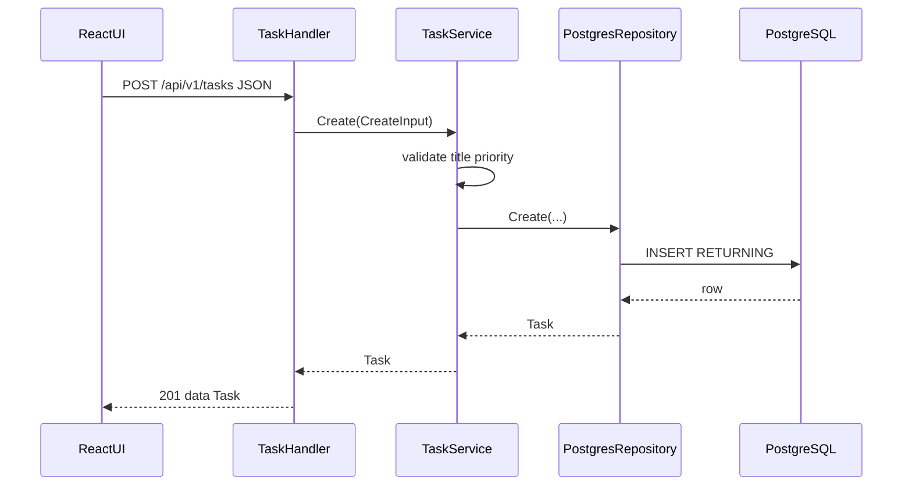

# TaskFlow – průvodce jazykem Go

Tento dokument tě provede Go od základů až po architekturu TaskFlow. Předpokládá znalost Reactu, TypeScriptu a Laravelu.

Názvy v kódu zůstávají anglicky. Vysvětlení je česky.

---

## Lekce 1 – Jak Go funguje

### Co je Go

Go (Golang) je kompilovaný jazyk od Google. Hodí se na API, CLI, infrastruktura a concurrent servery. Na rozdíl od PHP/TS nemá VM jako interpreter – vytváří nativní binárku.

### Kompilace

```bash
go build ./cmd/api
```

Kompilátor vezme packages, vyřeší dependency z `go.mod` a vytvoří jeden spustitelný soubor. V TaskFlow Docker image běží právě tato binárka `/app/api`.

### Runtime

Go runtime je součástí binárky. Obsahuje garbage collector, scheduler goroutines a síťový stack. Nemusíš instalovat samostatný runtime jako Node.

### `main.go`

Každý spustitelný program má package `main` a funkci `main()`:

```go
package main

func main() {
    // start serveru
}
```

V projektu: [`backend/cmd/api/main.go`](backend/cmd/api/main.go).

### Packages a modules

- **Package** = jeden adresář se soubory `.go` se stejným `package` jménem.
- **Module** = celý projekt definovaný v `go.mod`.

```go
module github.com/taskflow/taskflow/backend

go 1.27
```

Import interního balíčku:

```go
import "github.com/taskflow/taskflow/backend/internal/task"
```

Adresář `internal/` je speciální: kód uvnitř nelze importovat z jiných modulů.

### Rozdíl oproti PHP a TypeScriptu

| | Go | PHP / TS |
|---|---|---|
| Spuštění | kompilovaná binárka | interpret / Node |
| Typy | statické, kompilované | PHP dynamické / TS transpile |
| Závislosti | `go.mod` | Composer / npm |
| Chyby | návratové hodnoty | exceptions / try-catch |

---

## Lekce 2 – Syntaxe Go

### Proměnné

```go
var title string = "Learn Go"
priority := "medium" // short declaration
```

V TaskFlow: `cfg, err := config.Load()` v `main.go`.

### Datové typy a zero values

Každý typ má „nulovou“ hodnotu (`""`, `0`, `false`, `nil`). Proto default popis úkolu může být prázdný string bez `null`.

### Funkce a více návratových hodnot

```go
func (s *Service) Create(ctx context.Context, in CreateInput) (Task, error)
```

Idiom: vždy kontroluj `err`.

### Structs

```go
type Task struct {
    ID    uuid.UUID
    Title string
}
```

Obdoba class properties v TS/PHP, ale bez metod uvnitř definicí tříd – metody se vážou receivers.

### Pointers

```go
func NewService(repo Repository) *Service {
    return &Service{repo: repo}
}
```

`*Service` = ukazatel. Měníš jednu instanci, ne kopii. V TS objekty jsou reference by default; v Go structs se defaultně kopírují.

### Slices a maps

```go
items := make([]Task, 0)
tasks := map[uuid.UUID]Task{}
```

Slice ≈ dynamické pole. Map ≈ objekt/dictionary.

### Loops, conditions, switch

```go
for _, t := range items { ... }
if err != nil { ... }
switch status {
case StatusTodo:
}
```

### Methods a receivers

```go
func (s Status) Valid() bool { ... }
func (s *Service) Create(...) (Task, error)
```

Value receiver `(s Status)` vs pointer receiver `(s *Service)`.

### Defer

```go
defer pool.Close()
defer rows.Close()
```

Spustí se na konci funkce – ideální pro cleanup (jako `finally`).

---

## Lekce 3 – Interfaces

### Co je interface

Interface popisuje chování, ne data:

```go
type Repository interface {
    Create(ctx context.Context, title, description string, status Status, priority Priority) (Task, error)
    GetByID(ctx context.Context, id uuid.UUID) (Task, error)
    // ...
}
```

### Implicitní implementace

V Go **nepíšeš** `implements`. Stačí mít metody se správnými signaturami.

`PostgresRepository` i `MemoryRepository` oba splňují `Repository` bez deklarace.

### Srovnání s TypeScript

TS interface je hlavně o tvaru objektu. Go interface je o sadě metod (duck typing v compile-time).

### Proč mezi service a repository

```go
type Service struct {
    repo Repository
}
```

Service neví, jestli jde o Postgres nebo paměť. V testech používáme `NewMemoryRepository()`.

### Kdy interface nepotřebuješ

Pokud máš jednu implementaci a netestuješ přes mock, concrete typ stačí. Interface zaváděj u hranic vrstev.

---

## Lekce 4 – Error Handling

### `error` je interface

```go
type error interface {
    Error() string
}
```

### `if err != nil`

```go
t, err := s.repo.GetByID(ctx, id)
if err != nil {
    return Task{}, err
}
```

Go záměrně nepoužívá try/catch jako hlavní styl – chyby jsou explicitní.

### Sentinel errors

```go
var ErrNotFound = errors.New("task not found")
var ErrValidation = errors.New("validation error")
```

### `errors.Is` / `errors.As`

```go
if errors.Is(err, ErrNotFound) {
    // 404
}
```

### Wrapping

```go
return Task{}, fmt.Errorf("%w: title is required", ErrValidation)
```

`%w` zachová řetězec chyb pro `errors.Is`.

### Scénář: úkol neexistuje

1. Repository: `pgx.ErrNoRows` → `ErrNotFound`
2. Service: propustí chybu
3. Handler: `writeServiceError` → HTTP 404 + `NOT_FOUND`

Soubory: `repository.go`, `service.go`, `handler.go`.

---

## Lekce 5 – HTTP v Go

### `net/http` a ServeMux

```go
mux := http.NewServeMux()
mux.HandleFunc("GET /api/v1/tasks/{id}", h.Get)
```

Go 1.22+ má method-aware routing a path params (`r.PathValue("id")`).

### Handler

```go
func (h *Handler) Create(w http.ResponseWriter, r *http.Request)
```

- `ResponseWriter` – zapisuješ response
- `*Request` – čteš body, query, context

### JSON

```go
json.NewDecoder(r.Body).Decode(&in)
json.NewEncoder(w).Encode(payload)
```

Obálky jsou v `internal/httpx`.

### Middleware

Řetězec v `middleware.Chain`: RequestID → Logging → Recover → MaxBodyBytes.

### `context.Context`

Každý request má context. Posílá se do service/repository, aby šlo zrušit DB query při cancel/timeout.

### Graceful shutdown

```go
server.Shutdown(shutdownCtx)
```

Po SIGINT/SIGTERM server doklepává requesty a pak končí. Viz `main.go`.

---

## Lekce 6 – PostgreSQL v Go

### pgx a pgxpool

`pgx` je driver. `pgxpool` drží pool spojení:

```go
pool, err := pgxpool.New(ctx, cfg.DatabaseURL)
```

### Parametrizované SQL

```go
INSERT INTO tasks (...) VALUES ($1, $2, $3, $4)
```

Místo skládání stringů – prevence SQL injection.

### Scan

```go
err := row.Scan(&t.ID, &t.Title, ...)
```

Mapuje sloupce do Go proměnných.

### Migrace (Goose)

Soubor `migrations/00001_create_tasks.sql` má sekce `-- +goose Up` / `-- +goose Down`. Při startu API (pokud `RUN_MIGRATIONS=true`) se zavolá `goose.Up`.

### DB chyby

- `pgx.ErrNoRows` → not found
- constraint violation (`23514`) → validační/constraint problém

---

## Lekce 7 – Concurrency

### Goroutines

Lehká vlákna řízená Go schedulerem:

```go
go func() {
    server.ListenAndServe()
}()
```

V `main.go` server běží v gorutině, hlavní gorutina čeká na signal.

### Channels, mutexy, WaitGroup

- Channel: komunikace mezi gorutinami
- Mutex: ochrana sdílené paměti (`MemoryRepository` používá `sync.RWMutex`)
- WaitGroup: počká na dokončení skupiny gorutin

### Race conditions

Dva zápisy bez synchronizace. Detekce:

```bash
go test -race ./...
```

### Context cancellation

Zrušení requestu propaguje cancel do DB.

### vs JavaScript async/await

JS má event loop + Promise. Go má preemptivní scheduler gorutin a často synchronní styl kódu (`err := do()`), i když pod kapotou běží paralelně mnoho requestů.

Do TaskFlow nepřidáváme zbytečnou concurrency navíc – HTTP server ji už poskytuje.

---

## Lekce 8 – Architektura TaskFlow

### Důležité soubory

| Soubor | Role |
|---|---|
| `cmd/api/main.go` | wiring, migrace, server, shutdown |
| `internal/config/config.go` | env konfigurace |
| `internal/task/model.go` | domain typy + PATCH parsing |
| `internal/task/handler.go` | HTTP ↔ DTO |
| `internal/task/service.go` | business rules |
| `internal/task/repository.go` | SQL / Postgres |
| `internal/httpx/response.go` | JSON envelope |
| `internal/middleware/middleware.go` | cross-cutting concerns |

### Průchod requestu

```text
React UI
  ↓ POST /api/v1/tasks
Go ServeMux
  ↓
Handler.Create
  ↓ decode JSON → CreateInput
Service.Create
  ↓ validace title/priority
Repository.Create
  ↓ INSERT ... RETURNING
PostgreSQL
  ↓
Repository → Task
Service → Task
Handler → {"data": Task} + 201
React Query cache invalidate
UI update
```



---

## Lekce 9 – Porovnání s Laravelem a Reactem

| Concept | Go (TaskFlow) | Laravel / TypeScript |
|---|---|---|
| Controller / Handler | `Handler` metody | Controller action |
| Service | `task.Service` | Service class / Action |
| Repository | `Repository` interface + Postgres | Eloquent / Repository |
| Struct / Class | `struct` + methods | class |
| Interfaces | implicitní | TS structural / PHP explicit |
| DI | manuální wiring v `main` | Service container |
| Error handling | `error` values | Exceptions |
| HTTP lifecycle | ServeMux + middleware | Kernel middleware |
| Packages | Go modules | Composer / npm |
| Concurrency | goroutines | queues / async await |

**Technicky důležité:** Go nemá magický IoC container. Závislosti předáváš v `main` explicitně – to je záměrně čitelné.

---

## Lekce 10 – Go Interview Preparation

1. **Co je zero value?**  
   Výchozí hodnota typu (`""`, `0`, `nil`).  
   *TaskFlow:* prázdný `description`.

2. **Proč `err != nil`?**  
   Explicitní error handling bez skrytých exceptions.

3. **Co je interface v Go?**  
   Sada metod; implementace je implicitní.  
   *TaskFlow:* `Repository`.

4. **Pointer vs value receiver?**  
   Pointer když metoda mění stav nebo je struct velký.  
   *TaskFlow:* `*Service`.

5. **Co dělá `defer`?**  
   Odloží volání na konec funkce.  
   *TaskFlow:* `defer pool.Close()`.

6. **Jak funguje `go.mod`?**  
   Definuje module path a dependency.

7. **Co je goroutine?**  
   Lehká concurrent jednotka runtime.

8. **Jak zabránit race condition?**  
   Mutex / channel / žádné sdílení. Test `-race`.

9. **Co je `context.Context`?**  
   Deadline, cancel, request-scoped values.

10. **Jak Go routuje HTTP?**  
    `ServeMux` patterns včetně metody.

11. **Jak bezpečně psát SQL?**  
    Placeholdery `$1`, `$2` přes pgx.

12. **Co je connection pool?**  
    Znovupoužití DB spojení (`pgxpool`).

13. **Jak mapuješ DB row na struct?**  
    `Scan` do polí.

14. **Jak děláš partial update?**  
    Rozlišení absent vs null (u nás custom `UnmarshalJSON`).

15. **Graceful shutdown?**  
    `signal.NotifyContext` + `server.Shutdown`.

16. **`errors.Is` vs `==`?**  
    `Is` funguje i přes wrapping.

17. **Proč `internal/`?**  
    Enkapsulace proti importu z jiných modulů.

18. **Table-driven tests?**  
    Slice struktur se vstupy/výstupy (v Go idiomatické).

19. **Co vrací DELETE 204?**  
    Úspěch bez body.  
    *TaskFlow:* `WriteNoContent`.

20. **Jak testuješ handler bez DB?**  
    In-memory repository + `httptest`.

21. **Co je middleware?**  
    Wrapper `http.Handler`.

22. **Jak validuješ UUID?**  
    `uuid.Parse` → `ErrInvalidID`.

---

## Lekce 11 – Praktické úkoly

### Úkol 1 – Přidej endpoint počítadla high priority
**Zadání:** `GET /api/v1/tasks/priority-count?priority=high` vrátí počet.  
**Soubory:** `handler.go`, `service.go`, `repository.go`  
**Naučíš se:** nový query + routing  
**Test:** curl + unit test  
**Nápověda:** můžeš reuse `List` s `Limit:1` a číst `Total`, nebo napsat `COUNT`.

### Úkol 2 – Soft delete
**Zadání:** místo DELETE nastav `deleted_at`. List ignoruje smazané.  
**Soubory:** migrace, repository, service  
**Naučíš se:** migrace + filtrování  
**Test:** vytvoř → smaž → get 404 → raw SQL stále existuje  
**Nápověda:** nový sloupec `TIMESTAMPTZ NULL`.

### Úkol 3 – Sort query param
**Zadání:** `?sort=created_at_asc|created_at_desc`  
**Soubory:** handler, service, repository  
**Naučíš se:** whitelist sortů (žádný raw user input do ORDER BY)  
**Test:** vytvoř 2 úkoly, ověř pořadí  
**Nápověda:** mapuj enum na pevný SQL fragment.

### Úkol 4 – Rate-limit middleware (in-memory)
**Zadání:** max N requestů / IP / minutu → 429  
**Soubory:** `middleware/`  
**Naučíš se:** mutex map + HTTP 429  
**Test:** httptest smyčka  
**Nápověda:** klíč = IP z `RemoteAddr`.

### Úkol 5 – Activity log table
**Zadání:** při create/update/delete zapisuj audit řádek v transakci.  
**Soubory:** repository (tx), migrace  
**Naučíš se:** `pgx.Tx`, atomicita  
**Test:** integrační test počtu logů  
**Nápověda:** `pool.Begin(ctx)`.

---

## Lekce 12 – Fullstack komunikace Go ↔ React

1. React klikne „Uložit“ v `TaskModal`.
2. `useCreateTask` zavolá `createTask()` ve `lib/api.ts`.
3. `fetch('/api/v1/tasks', { method:'POST', body })`.
4. Dev: Vite proxy → `:8080`. Prod Docker: nginx proxy → `backend:8080`.
5. Go `Handler.Create` dekóduje JSON do `CreateInput`.
6. Service validuje, repository provede `INSERT`.
7. PostgreSQL vrátí řádek, handler odešle `{ data: task }` + 201.
8. TanStack Query invaliduje cache (`taskKeys.all`).
9. Dashboard / Tasks / Board se překreslí z nových dat.
10. Optimistic update na boardu mění cache hned; při chybě rollback.

Proč dvě aplikace? Oddělené lifecycle, škálování a technologie. Domlouvají se přes HTTP/JSON kontrakt.
